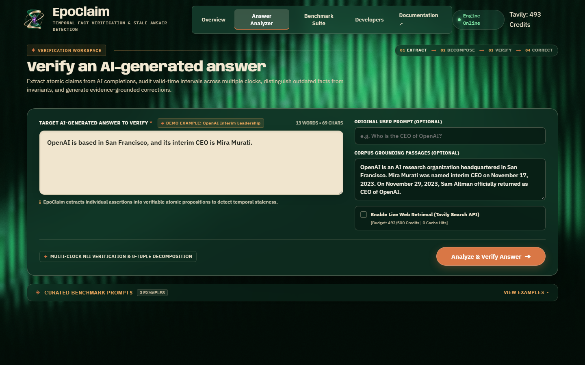
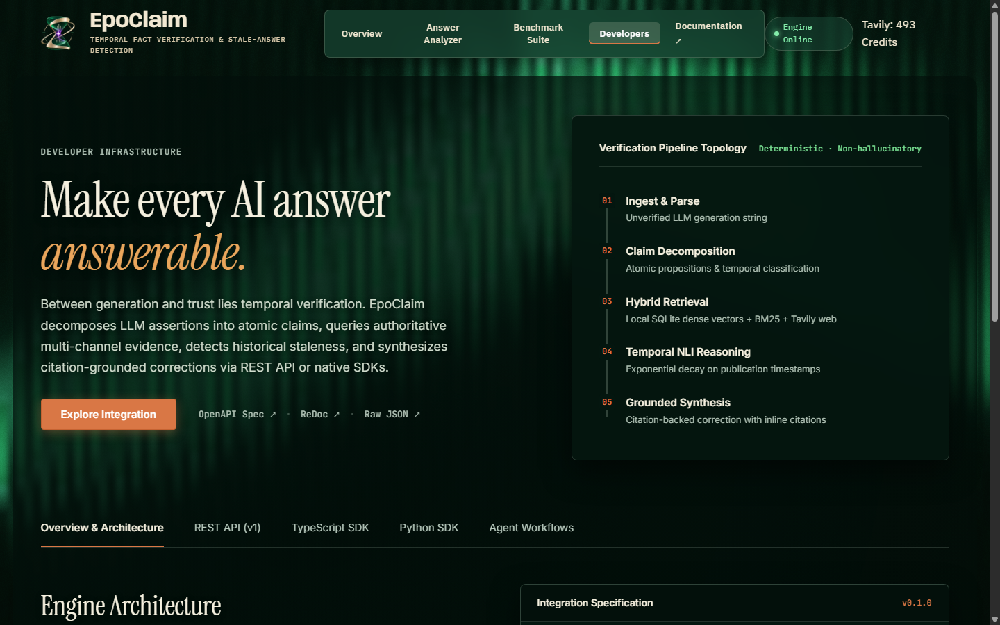
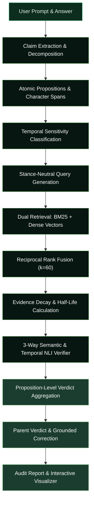

# EpoClaim

> **AI ANSWERS AGE. WE VERIFY WHAT'S TRUE NOW.**

[](https://www.python.org/)
[](https://fastapi.tiangolo.com/)
[](https://react.dev/)
[](https://www.typescriptlang.org/)
[](https://threejs.org/)
[](LICENSE)
[](backend/tests/)

**EpoClaim** is a research-grade temporal freshness and factual verification engine for AI-generated answers. It dissects compound assertions into atomic propositions, retrieves stance-neutral evidence across time, models exponential information decay, and mathematically resolves whether an answer is actively supported, superseded, or completely contradicted by current reality.

---

## Screenshot Gallery

| Overview & Temporal Hourglass | Forensic Answer Analyzer |
|:---:|:---:|
|  |  |
| *Landing overview featuring the interactive 3D WebGL temporal collision hourglass* | *Main analysis engine displaying decomposed propositions, timeline drift, and grounded corrections* |
| **Benchmark Suite & Provenance** | **Developer Hub & SDK Quickstarts** |
|  |  |
| *18-scenario stress harness with transparent runtime provenance and 5×5 confusion matrix* | *Interactive REST explorer, API keys, rate limiters, and Python / TypeScript SDK integration hub* |

---

## About EpoClaim

Large Language Models frequently produce answers that were factually true during pre-training but have since become obsolete due to executive succession, software releases, or regulatory shifts. Conventional fact-checkers fail because they treat facts as static and time-invariant.

EpoClaim solves this through temporal-aware verification:
1. **Decomposes** complex answers into atomic predicate-argument propositions with exact character spans.
2. **Retrieves** corroborating and refuting evidence using stance-neutral Reciprocal Rank Fusion (RRF).
3. **Applies True Half-Life Decay**: Models evidence age using strict exponential decay:
   $$F(\text{age}) = 2^{-\text{age} / T_{1/2}} = \exp\left(-\frac{\ln(2) \cdot \text{age}}{T_{1/2}}\right)$$
4. **Distinguishes Temporal Invariance from Decay**: Historical milestones (e.g. Apollo 11) retain full validity, while volatile facts decay unless corroborated by current evidence.
5. **Issues Auditable Verdicts**: Assigns `SUPPORTED`, `CONTRADICTED`, `OUTDATED`, `PARTIALLY_SUPPORTED`, or `INSUFFICIENT_EVIDENCE` accompanied by evidence citations and grounded corrections.

---

## Core Capabilities

- **Atomic Proposition Decomposition**: Splits multi-sentence assertions and contrastive clauses into atomic propositions without evidence bleeding.
- **Stance-Neutral Evidence Retrieval**: Combines BM25 lexical search with dense vector scoring via Reciprocal Rank Fusion ($k=60$) so contradictory evidence is never suppressed.
- **Temporal Supersedence Engine**: Dynamically detects when newer authoritative facts invalidate previous valid states.
- **Bitemporal Reasoning**: Separates event valid time from document publication time and transaction time (`evaluation_as_of`).
- **Grounded Correction Synthesis**: Generates factual corrections grounded strictly in authoritative citations with zero speculative filler.
- **Empirical Benchmark Suite**: Evaluates 18 dual-modality scenarios across 36 trials with exact versus policy-normalized accuracy metrics.
- **Transparent Provenance**: Telemetry discloses whether evaluations executed via live search, configured LLMs, or bounded deterministic fallbacks.
- **Multi-Client SDK Support**: Full-featured Python and TypeScript client libraries with built-in retry and budget-cap safeguards.

---

## Technology Stack

```
Frontend Architecture         Backend Pipeline              AI & Algorithmic Core
─────────────────────         ────────────────              ─────────────────────
React 19 (TypeScript)         FastAPI & Uvicorn             BM25Okapi (rank-bm25)
Vite 8 & Rolldown Bundler     Pydantic v2 (Strict Typing)   Dense Semantic Vector Search
Three.js (WebGL Visuals)      SQLite (WAL Persistence)      Reciprocal Rank Fusion (RRF)
Lucide Icons & Tailwind CSS   HTTPX (Async Networking)      Deterministic Fallback Verifier
```

- **Frontend**: React 19, TypeScript 5.7+, Vite 8, Three.js (interactive 3D particle canvas), vanilla CSS tokens.
- **Backend**: Python 3.10+ (tested on Python 3.13), FastAPI 0.115+, Pydantic v2 Settings & Schemas, Uvicorn ASGI.
- **Retrieval & Verification**: `rank-bm25`, vector space dense retrieval, Reciprocal Rank Fusion, Bifrost Gemini API client with graceful deterministic NLI fallback.
- **Storage & Infrastructure**: SQLite with persistent write-ahead logging (WAL), local token cache, Tavily rate-limited search client.

---

## Benchmark Snapshot

EpoClaim is evaluated against an 18-scenario (36 dual-modality trial) empirical test suite executing end-to-end through `EpoClaimPipeline`:

| Metric | Measured Score | 95% Wilson Confidence Interval | Evaluated Population |
| :--- | :---: | :---: | :--- |
| **Parent Verdict Accuracy** | **100.0%** (36 / 36) | [90.36%, 100.0%] | All evaluated trial scenarios |
| **Exact Verdict Accuracy** | **97.22%** (35 / 36) | [85.83%, 99.51%] | Exact string equality (`exact_pass`) |
| **Normalized Verdict Accuracy**| **100.0%** (36 / 36) | [90.36%, 100.0%] | Validated temporal equivalence policy |
| **Stale Detection Rate** | **100.0%** (6 / 6) | [60.97%, 100.0%] | Superseded/stale ground truth |
| **Fresh Acceptance Rate** | **100.0%** (16 / 16) | [80.64%, 100.0%] | Fresh supported statements |
| **False Stale Rate** | **0.0%** (0 / 18) | [0.0%, 17.59%] | Fresh assertions penalized |
| **Overall Abstention Rate** | **11.11%** (4 / 36) | [4.41%, 25.32%] | Predicted `INSUFFICIENT_EVIDENCE` |
| **Abstention Fidelity** | **100.0%** (4 / 4) | [51.01%, 100.0%] | Unverifiable ground truth |

*Provenance Note: All benchmark trials executed offline with bounded in-memory passage fixtures consuming 0 Tavily search credits, utilizing the Deterministic Semantic Matcher with fallback active. Detailed logs are documented in [`docs/BENCHMARK_INTEGRITY_FINAL_AUDIT.md`](docs/BENCHMARK_INTEGRITY_FINAL_AUDIT.md).*

---

## Architecture



---

## Developer

**Souvik Dey — Lead Architect & Developer**

Researched, architected, and engineered EpoClaim, including its temporal decay mathematics, proposition decomposition engine, stance-neutral evidence reranker, bitemporal evaluation suite, SDKs, and forensic web interface.

- **GitHub Profile**: [@Souvik-Dey-2029](https://github.com/Souvik-Dey-2029)
- **Repository**: [https://github.com/Souvik-Dey-2029/EpoClaim](https://github.com/Souvik-Dey-2029/EpoClaim)

---

## Getting Started

### Prerequisites

- Python 3.10+ (tested on Python 3.13)
- Node.js 18+ and npm

### 1. Installation

```bash
# Clone the repository
git clone https://github.com/Souvik-Dey-2029/EpoClaim.git
cd EpoClaim

# Install backend dependencies
cd backend
pip install -r requirements.txt
cd ..

# Install frontend dependencies
cd frontend
npm install
cd ..
```

### 2. Configuration (Optional)

```bash
copy backend\.env.example backend\.env
```
*(Optional) Configure `EPOCLAIM_TAVILY_API_KEY` for live search. If omitted, EpoClaim defaults cleanly to offline deterministic reference mode.*

### 3. Running EpoClaim

**Start Backend Server:**
```bash
python -m uvicorn app.main:app --app-dir backend --host 127.0.0.1 --port 8000
```
- Interactive Swagger API: `http://127.0.0.1:8000/docs`
- Health check: `http://127.0.0.1:8000/api/v1/health`

**Start Frontend UI:**
```bash
cd frontend
npm run dev
```
- Open your browser at `http://localhost:5173`

**Run Test Suite:**
```bash
python -m pytest backend/tests -v
```

---

## Attribution & Legal Notices

EpoClaim incorporates architectural patterns and methodologies from open-source research projects:

- **StaleBench** (`KaranSinghDev/StaleBench`, Apache 2.0): Evaluation concepts, Wilson 95% score interval formulations, and whole-token phrase matching adapted under Apache 2.0.
- **LLM Hallucination Detector** (`SYasJ/llm-hallucination-detector`, MIT): Payload size validation, request sanitation, and error masking patterns adapted under MIT.
- **RAGEval** (`pandeyvishwas51-oss/rageval`, MIT): Evaluation registry patterns and ISO temporal parser adapted under MIT (with half-life decay math corrected to strict $2^{-\text{age}/T_{1/2}}$).
- **Independent Implementations**: All Reciprocal Rank Fusion, BM25 ranking, stance-neutral reranking, decomposition logic, and bitemporal reasoning routines are independently authored clean-room implementations.

For full license texts and copyright statements, please see [`THIRD_PARTY_NOTICES`](THIRD_PARTY_NOTICES) and [`LICENSE`](LICENSE).
